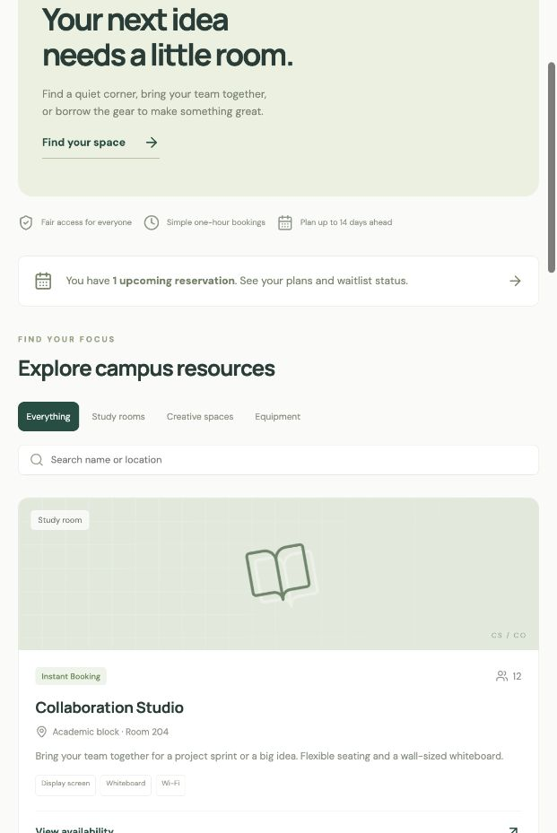

# CampusSlot
### Make room for your next idea.

Campus room and equipment reservations, built with MongoDB, Express, React, and Node.js.

**Live app:** https://campusslot-phi.vercel.app

The public deployment uses MongoDB Atlas. Create a student account from Sign in → Create an account. Manager credentials are kept private. The temporary Atlas network rule expires **30 October 2026, 16:22 IST** and must be replaced or renewed if evaluation continues afterward.

## Problem and target users
Students often coordinate shared rooms, cameras, and projectors through messages. Availability becomes unclear and two groups can arrive expecting the same resource. CampusSlot serves students and resource managers with a single reservation workflow.

## Preview


## What works
- Student registration, login, persistent sessions, and logout.
- Search by resource name/location and filter by category.
- Live hourly availability in Asia/Kolkata, with capacity and date validation.
- Immediate bookings or manager-reviewed requests. Pending requests hold their slot.
- First-in-first-out waitlists: cancellation or rejection promotes the earliest waiting request.
- Private booking history and persistent notification inbox.
- Manager approvals with notes, resource creation, and pause/reopen controls.

All catalog entries are fictional examples, not actual campus availability. The local sandbox is for demonstration only.

## Local setup
Use Node.js 22.12+ and npm.

```sh
npm ci
npm run build
npm run demo
```

Open **http://localhost:4000**. The demo command starts an actual local MongoDB replica set; its first run downloads a MongoDB binary. Data is saved in ignored `.data/mongo` and retained on graceful restart.

Local-only demo logins:
- `student@campusslot.local`
- `manager@campusslot.local`
- Password for both: `CampusDemo2026!`

Do not publish this demo process. It binds to loopback and refuses production mode.

### Use your own MongoDB
Create `.env` from `.env.example` and set `MONGODB_URI`. Use Atlas or a local MongoDB replica set (transactions require it). CampusSlot explicitly uses the **campusslot** database, separate from other applications on the cluster.

```sh
npm run seed
npm run dev
```

Open http://localhost:5173. For a production-style local build, set `APP_ORIGIN=http://localhost:4000`, run `npm run build`, then `npm start`.

To create a manager, set `SEED_ADMIN_EMAIL` and `SEED_ADMIN_PASSWORD` (at least 12 characters) in the untracked `.env`, run `npm run seed`, then remove those two variables. Registration always creates students. Seeding never changes existing passwords or elevates existing accounts.

## Environment variables
| Variable | Purpose |
|---|---|
| `MONGODB_URI` | Server-only database connection string. Never prefix with `VITE_`. |
| `APP_ORIGIN` | Exact browser origin, e.g. `https://your-app.vercel.app`. Used to reject cross-origin mutations. |
| `NODE_ENV` | `production` enables Secure cookies. |
| `PORT` | Express server port, defaults to 4000. |
| `SEED_ADMIN_EMAIL`, `SEED_ADMIN_PASSWORD` | Optional manager provisioning, used only by the seed script. |

## Architecture
Browser → React feature components → same-origin `/api` → Express authentication/validation → booking service → MongoDB → JSON response → refreshed UI.

- `client/src/`: feature components, shared UI, API client, responsive CSS.
- `server/app.js`: HTTP routes and error handling.
- `server/auth.js`: opaque sessions in HttpOnly cookies; session token hashes stored in MongoDB.
- `server/bookings.js`: transaction-based reservation and state transitions.
- `server/models.js`: schemas and uniqueness constraints.
- `api/index.js`: optional Vercel adapter with a cached database connection.
- `tests/workflows.test.js`: integration tests against MongoDB.

See [architecture](docs/ARCHITECTURE.md), [API](docs/API.md), [deployment](docs/DEPLOYMENT.md), [demo walkthrough](docs/DEMO.md), and [submission readiness](docs/SUBMISSION.md).

## Engineering decisions
One-hour slots make overlap checks understandable and efficient. A partial unique index on `(resource, start)` applies only to active bookings. A second index prevents duplicate live requests from one student for the same resource/time. All booking operations update a shared resource revision inside a transaction, serializing reservations and waitlist promotion for that resource. Database indexes remain the final guard against duplicate occupancy.

Passwords are bcrypt-hashed. The browser never receives password hashes. Logout deletes the server session. Roles and ownership are enforced on the server. Credentials live in ignored environment files. Input is validated with Zod. Mutating browser requests must come from the configured origin. Cookies are HttpOnly/SameSite=Lax and Secure in production.

## Tests
```sh
npm test
npm run build
```
The tests cover concurrent booking conflicts, FIFO waitlists, ownership, role restrictions, approval/rejection transitions, invalid capacity/date/hour, duplicate entries, literal search input, logout, and persistence after signing in again. GitHub Actions runs both commands.

## Deliberate limits
- No recurring or multi-hour reservations, email delivery, payments, password reset, or verified campus enrollment.
- Notifications refresh on navigation rather than using sockets.
- Lists show the latest 200 bookings and 50 notifications; this is a small-campus project, not a large production scheduler.
- Managers can pause resources; existing reservations remain valid. While paused, released slots do not promote waiters. Reopening promotes the oldest waiting request for each free future slot.
- Rate limiting uses process memory. A multi-instance public rollout should use a shared store.
- Reservation status is retained as history after a slot passes; the UI classifies these as past bookings.
- Students may reserve different resources at the same time (e.g. a room and a projector).

## Originality and assistance
This is an original implementation for the end-term project. The course repository was consulted for requirements and concepts, not copied as an application template. AI assistance was used for implementation, documentation, and testing. The student should review the code and demonstrate their understanding during evaluation.

Course guidelines: https://github.com/mrinal1224/social_media_B/blob/main/END_TERM_PROJECT_GUIDELINES.md
