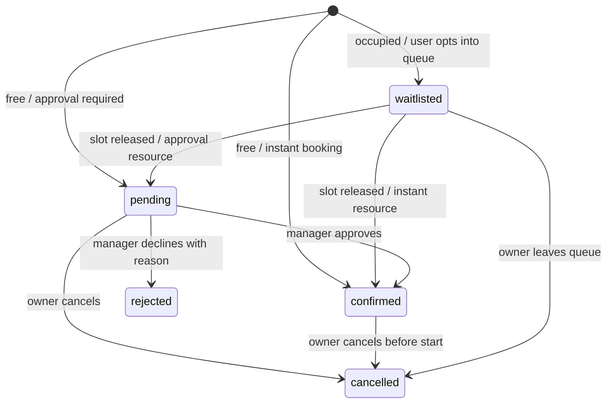

# Architecture and tradeoffs

## Data model
User: name, unique email, bcrypt password, student/manager role.
Session: SHA-256 hash of a random token, user, expiry with TTL index. Requests also check expiry, so TTL cleanup timing does not extend access.
Resource: category, location, capacity, approval policy, active flag, revision.
Booking: student, resource, UTC start, purpose, group size, status, active/live flags, manager note.
Notification: owner, message, read flag, timestamp.

`active` means the booking occupies the slot. `live` means the request has not been cancelled/rejected. Confirmed and pending entries are active/live; waitlisted entries are live only. Cancellation and rejection clear both.

## Booking lifecycle

## Why a transaction?
Cancellation must update the old booking, promote a waiter, and create notifications together. Without a transaction, a crash between writes can leave an empty slot or an inaccurate inbox. MongoDB replica sets support transactions; standalone MongoDB does not.

The service updates the Resource revision before queue mutations. Concurrent transactions writing that resource conflict and retry, so a new reservation cannot race ahead of a waiting student during release. Partial unique indexes protect occupancy and duplicate live requests. The integration suite sends simultaneous requests to check this behavior.

## Security boundary
React hides manager navigation, but Express is the actual authority. Session middleware loads the current user from the database. Signup ignores client-supplied roles. Cancellation compares the session user to the booking owner. Approval requires a manager. User identity is never accepted from a booking payload.

Origin validation, SameSite cookies, and JSON requests protect browser mutations from cross-site requests. An absent Origin is accepted for same-origin/non-browser tooling; authentication is still mandatory. Production uses HTTPS and Secure cookies. Server errors are sanitized; database internals are not returned to clients.

## Time
Bookings are one hour long and aligned to an hour between 08:00 and 20:00 IST. Dates are explicitly interpreted with +05:30, stored as UTC Dates, and rendered in Asia/Kolkata. Server time is authoritative. Maximum booking horizon is 14 × 24 hours ahead.

## Deployment
A single origin serves static React assets and the Express API through a Vercel function. MongoDB Atlas persists sessions/bookings independently of function lifetimes. The connection promise is reused for warm invocations; each instance limits its connection pool. A conventional Node server deployment is also supported with `npm start`.
